 

  

<h1 align="center">Hi, I'm Ankit Rauthan 👋</h1>

  <strong>Aspiring Data Analyst</strong> · SQL · Advanced Excel · Power BI · Python

  I work with data to uncover patterns, understand business performance, and communicate findings through clear analysis and dashboards.

  
  
  

---

## About Me

- 📊 Interested in data analysis, business reporting, and dashboard development.
- 🔎 Use SQL and Python to explore data, and Excel and Power BI to analyze and communicate results.
- 🧩 Focus on turning business questions into understandable metrics and actionable findings.
- 🌱 Continuously building practical projects and strengthening my analytical toolkit.

## Featured Projects

### 🚗 Ola Ride Performance Analytics

**Tools:** SQL · Advanced Excel · Power BI

Explore ride performance and operational KPIs, including booking trends, cancellations, and customer experience. The project uses dashboard-driven analysis to support business decisions.

[**View repository →**](https://github.com/AnkitRauthan1441/ola-performance-project-sql-excel-powerbi)

### 🛒 E-Commerce Sales & Profitability Dashboard

**Tools:** Power BI · DAX · Power Query · Excel

Track sales, revenue, and profitability KPIs; compare product and category performance; and present business trends through interactive visualizations.

[**View repository →**](https://github.com/AnkitRauthan1441/E-Commerce-Performance-Dashboard-Excel-Power-Bi)

### 📈 Sales Performance Analytics Dashboard

**Tools:** Microsoft Excel · PivotTables · Charts · Dashboarding

Analyze sales and profit performance, compare customer segments and product subcategories, and identify salesperson performance and product profitability.

[**View repository →**](https://github.com/AnkitRauthan1441/Sales-Performance-Analytics-Dashboard)

## Technical Toolkit

  

  

## GitHub Activity

  

> GitHub statistics and contribution cards are provided by external services. Their availability and reported data may vary.

## Connect

  
  

- **LinkedIn:** [Ankit Rauthan](https://www.linkedin.com/in/ankit-rauthan-1815a5415/)
- **Portfolio:** [Explore Portfolio](https://ankittrtth1441-portfolio.netlify.app/)
- **Email:** [ANKITRTH81945@GMAIL.COM](mailto:ANKITRTH81945@GMAIL.COM)

  

  Turning raw data into meaningful business insights.

