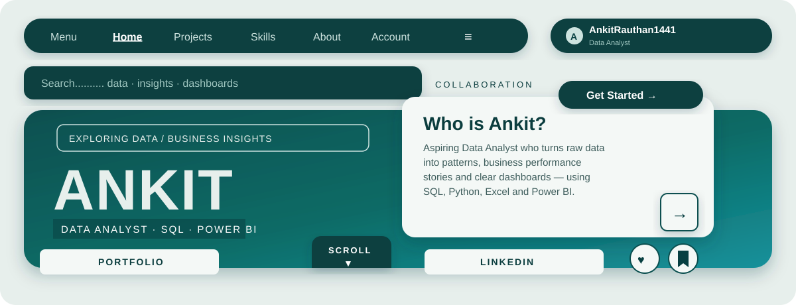
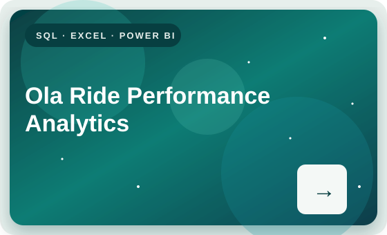
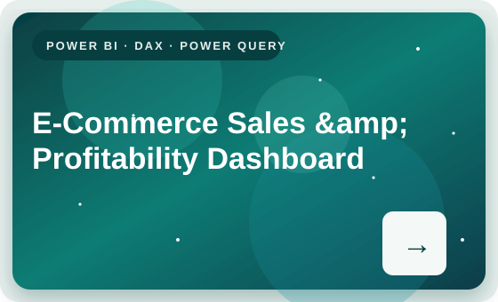
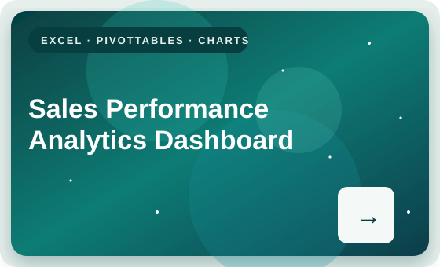

<!-- ============================================================ -->
<!--  ANKIT RAUTHAN — GitHub Profile README                        -->
<!--  Style: deep-teal layered-card poster design                 -->
<!--  (pill nav, overlapping info card, folder-tab sections,       -->
<!--   nebula gallery cards, pill footer)                          -->
<!--  SETUP: copy the 5 SVGs from teal-style-assets/ into your     -->
<!--  repo's assets/ folder, keeping these exact file names.       -->
<!-- ============================================================ -->

  

<!-- ── Pill navigation bar (mirrors the poster's top menu) ── -->

  
  
  
  
  

<h1 align="center">Hi, I'm Ankit Rauthan 👋</h1>

  <strong>Aspiring Data Analyst</strong> · SQL · Advanced Excel · Power BI · Python

  I work with data to uncover patterns, understand business performance, and communicate findings through clear analysis and dashboards.

  

  
  
  
  

---

## 🗂️ About Me &nbsp;·&nbsp; `PERBEDAAN / THE DIFFERENCE`

<!-- Two folder-tab cards, like the poster's middle section -->
<table>
  <tr>
    <td width="50%" valign="top">
      <h3>📊 Raw data vs. real insight</h3>
      
Raw data on its own is just rows and columns. Analysis is what connects it — I use SQL and Python to explore data, and Excel and Power BI to analyse it and communicate the result, turning business questions into understandable metrics and actionable findings.

      
<strong>Example projects &gt;</strong> — see the gallery below

    </td>
    <td width="50%" valign="top">
      <h3>🟢 Featured focus: Dashboards</h3>
      
Like a rare galaxy spotted in a survey, a good dashboard stands out because it is small, clear and bright: the right KPIs, honestly calculated, presented so a decision-maker gets the story in seconds. That is the standard I build every project to.

      
🔭 Currently building practical projects and strengthening my analytical toolkit.

    </td>
  </tr>
</table>

- 📊 Interested in data analysis, business reporting, and dashboard development.
- 🔎 Use SQL and Python to explore data, and Excel and Power BI to analyze and communicate results.
- 🧩 Focus on turning business questions into understandable metrics and actionable findings.
- 🌱 Continuously building practical projects and strengthening my analytical toolkit.
- 📫 Reach me at **ankitrth81945@gmail.com** — open to collaboration on data analysis and reporting projects.

  

---

## 🖼️ Featured Projects &nbsp;·&nbsp; `PAGE / GALLERY`

<!-- Nebula gallery cards — click a card to open the repository -->

  
  

  

### 🚗 Ola Ride Performance Analytics
**Tools:** SQL · Advanced Excel · Power BI

Explore ride performance and operational KPIs, including booking trends, cancellations, and customer experience. The project uses dashboard-driven analysis to support business decisions.

[**View repository →**](https://github.com/AnkitRauthan1441/ola-performance-project-sql-excel-powerbi)

### 🛒 E-Commerce Sales & Profitability Dashboard
**Tools:** Power BI · DAX · Power Query · Excel

Track sales, revenue, and profitability KPIs; compare product and category performance; and present business trends through interactive visualizations.

[**View repository →**](https://github.com/AnkitRauthan1441/E-Commerce-Performance-Dashboard-Excel-Power-Bi)

### 📈 Sales Performance Analytics Dashboard
**Tools:** Microsoft Excel · PivotTables · Charts · Dashboarding

Analyze sales and profit performance, compare customer segments and product subcategories, and identify salesperson performance and product profitability.

[**View repository →**](https://github.com/AnkitRauthan1441/Sales-Performance-Analytics-Dashboard)

---

## 🧰 Technical Toolkit &nbsp;·&nbsp; `ITS TYPE VARIATION`

  
  
  
  

  
  
  
  
  
  
  
  
  
  
  

---

## 📈 GitHub Activity

  

  

  

> GitHub statistics and language cards are provided by external services. Their availability and reported data may vary.

---

## 🤝 Connect &nbsp;·&nbsp; `SPECIAL COLLABORATION`

- **LinkedIn:** [linkedin.com/in/ankit-rauthan-1815a5415](https://www.linkedin.com/in/ankit-rauthan-1815a5415/)
- **Portfolio:** [ankittrtth1441-portfolio.netlify.app](https://ankittrtth1441-portfolio.netlify.app/)
- **Email:** [ankitrth81945@gmail.com](mailto:ankitrth81945@gmail.com)

  

Turning raw data into meaningful business insights.

